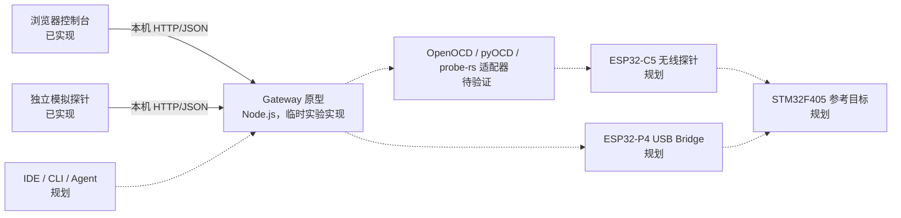
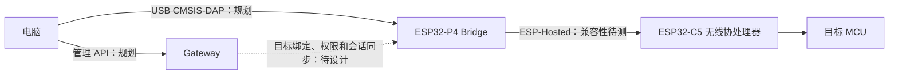
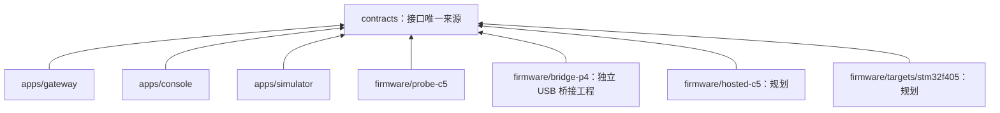
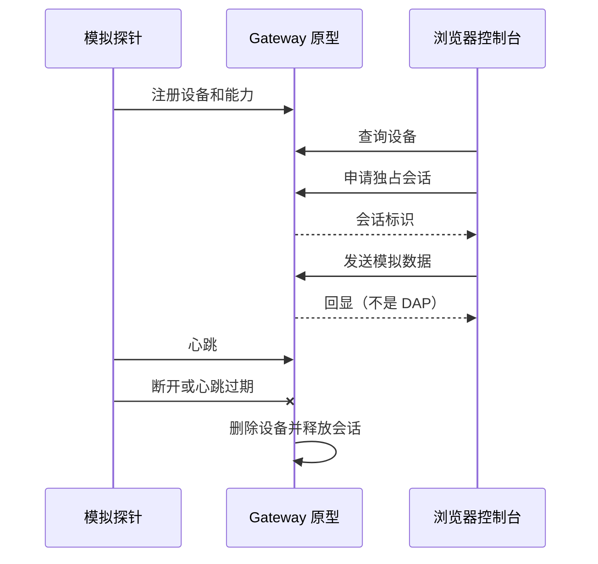
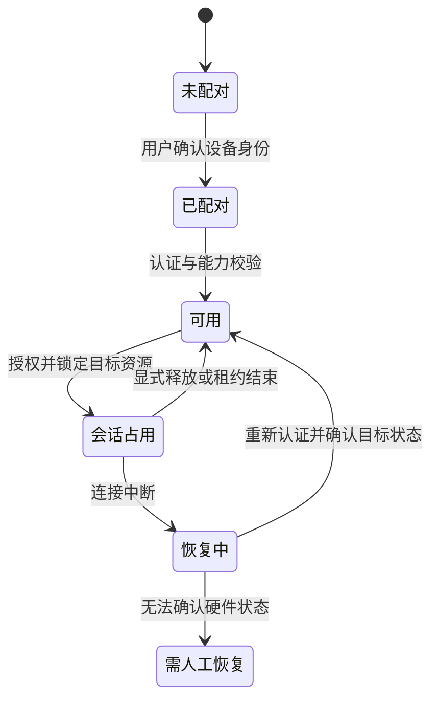
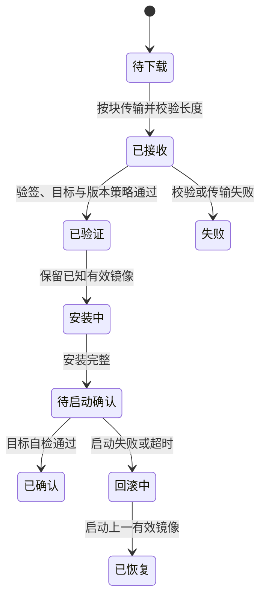
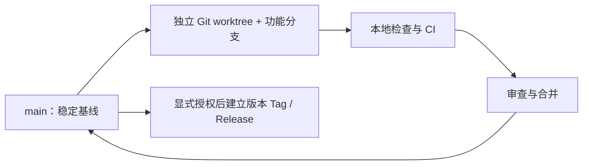

# 总体架构

## 状态与边界

本仓库目前实现的是本机原型，不是已完成的产品架构。图中 **实线** 表示当前模拟链路，**虚线** 表示规划或待验证能力。Gateway 先按模块化单体组织；设备实时 SWD/JTAG、UART 和其他总线事务应在拥有硬件引脚的探针上完成。

## 纯 C5 无线探针路线

Gateway 管理发现、身份、权限、会话和工具适配；探针在本机执行 CMSIS-DAP 和实时引脚操作。配对、加密、发现方式、重连及 TLS 资源预算仍未定，不能将模拟 API 当成设备链路。

这条路线独立验证电脑 Gateway 直接管理 C5：C5 自己执行 SWD/JTAG、UART、SPI 和 I2C 事务，电脑只承担发现、认证、租约和协议适配。双 C5 AP/STA 的关联、DHCP、HE20 和断连证据只能证明无线链路状态；RPC、DAP、目标 MCU OTA 和掉电恢复仍需在同一条路线中分别验收。

## P4 + C5 USB 桥接路线

P4 复合 USB 设备、CDC、CMSIS-DAP v2 Bulk、USB High-Speed 能力和目标绑定必须在 P4 板卡、PHY、驱动和接线明确后单独验证。电脑端 Gateway 管理通道与 USB 调试通道最终共享目标会话，但不能用纯 C5 无线结果替代这条路线的 USB、P4-C5 链路或目标事务证据。当前 `firmware/bridge-p4` 只提供有界 CDC 帧和离线安全响应骨架，未宣称 High-Speed 或 CMSIS-DAP 已通过。

## 工程依赖与所有权

公共契约只定义接口，不依赖任何业务工程。Gateway、模拟器和固件通过契约通信；固件工程不得引用其他固件工程的私有源码。

## 模拟链路与硬件责任

当前原型只在 Gateway 进程内保存设备和会话状态。设备断开或心跳超时后，Gateway 必须释放其会话。真实设备身份、认证和分布式状态恢复尚未实现。

## 权限与会话（目标生命周期，未实现）

当前原型仅以一个活跃会话和本机回环限制模拟独占，不代表生产级权限模型。生产配对应验证身份，再按设备与资源授权；租约、取消、断线清理和恢复语义需由 Gateway 与探针契约共同定义。

## OTA 生命周期（规划）

Gateway 调度任务，探针负责传输，目标 Bootloader 执行授权检查、安装和启动确认。当前没有镜像签名链、备份布局、Bootloader 或回滚能力；不得覆盖唯一有效镜像，也不得在开发阶段烧写 eFuse/RDP 等不可逆配置。

## Worktree 与发布流程

`VERSION` 是项目版本唯一人工维护来源；协议、Schema、硬件修订和安全版本各自独立管理。普通提交、CI 和初始化不得自动改版本、打 Tag 或发布 Release。
